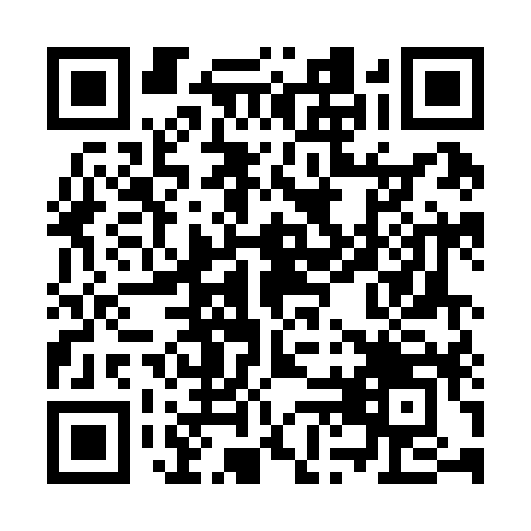
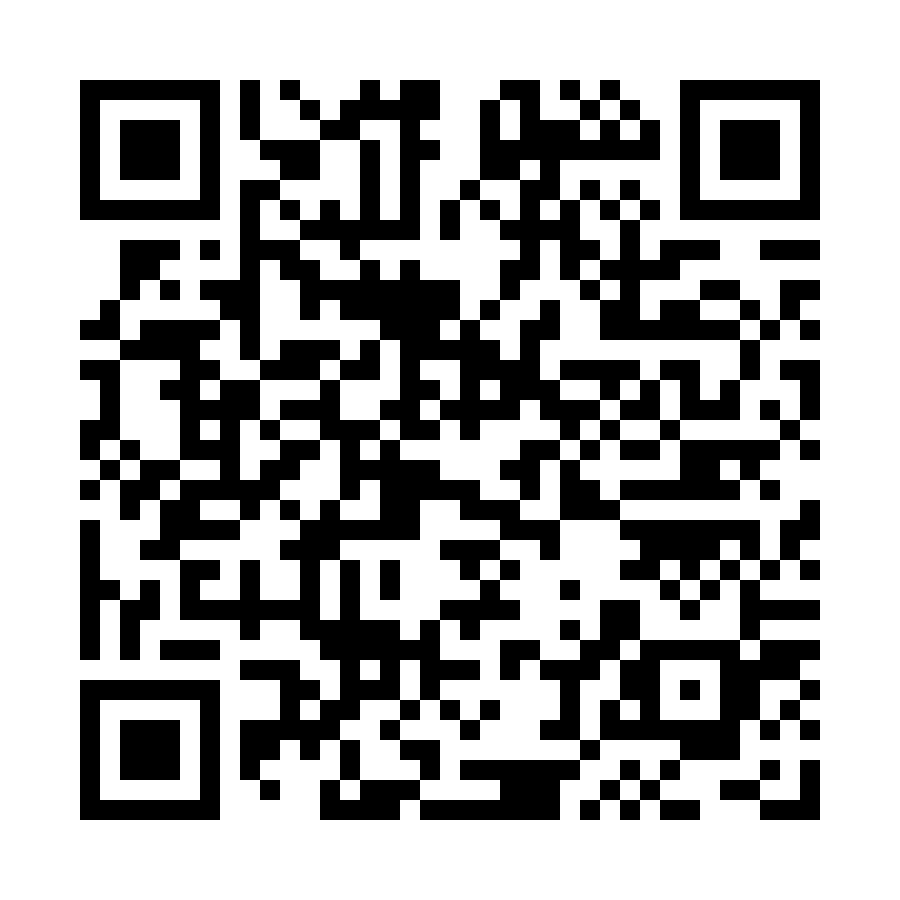
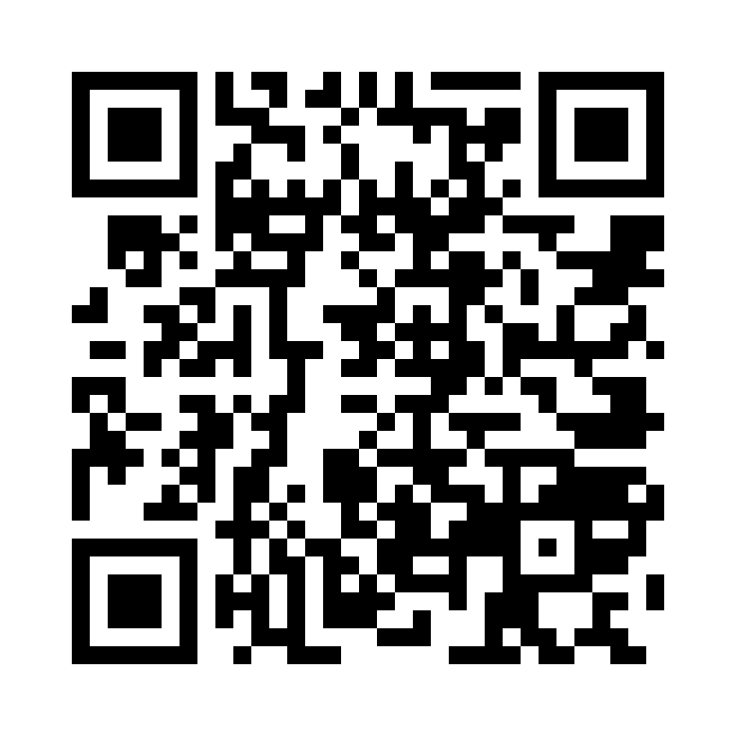
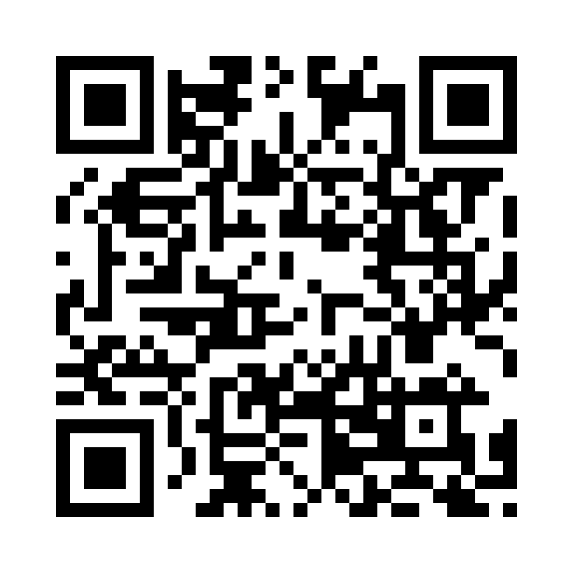

<p align="center">
  English · <a href="./README.es.md">Español</a>
</p>

<p align="center">
  <a href="https://cybergems.org/apps/cybersnap/">
    
  </a>
</p>

<p align="center">
  <a href="https://github.com/CyberGems/CyberSnap/releases/latest"></a>
  &nbsp;<a href="https://github.com/CyberGems/CyberSnap/releases"></a>
</p>

<p align="center">
  &nbsp;
  &nbsp;
  &nbsp;
  <a href="https://github.com/CyberGems/CyberSnap/wiki"></a>&nbsp;
  <a href="https://github.com/CyberGems/CyberSnap/blob/main/CHANGELOG.md"></a>
</p>

---

<div align="center">

### Capture, edit and share anything on screen — screenshots, recordings, OCR, QR codes and a color picker

</div>

---

## 📑 Table of Contents

- [👋 Introduction](#-introduction)
- [🖼️ Screenshots](#️-screenshots)
- [📸 Why CyberSnap?](#-why-cybersnap)
- [✨ Key Features](#-key-features)
- [🚀 Getting Started](#-getting-started)
- [🛠️ Tech Stack & Architecture](#️-tech-stack--architecture)
- [⌨️ Keyboard Shortcuts](#️-keyboard-shortcuts)
- [🤝 Contributing](#-contributing)
- [🙏 Acknowledgments](#-acknowledgments)
- [❤️ Donate](#️-donate)
- [📄 License](#-license)
- [❓ FAQ](#-faq)
- [🔗 See also](#-see-also)

<details>
<summary><strong>🔗 Related links (outside this README)</strong></summary>

- 🌐 [CyberSnap on the web](https://cybergems.org/apps/cybersnap/) — overview, download and SmartScreen guide
- 📚 [Documentation & FAQ — Wiki](https://github.com/CyberGems/CyberSnap/wiki) — troubleshooting and deep-dives
- 💾 [Releases](https://github.com/CyberGems/CyberSnap/releases) — installers, portable builds and changelog
- 🟣 [CyberGems suite](https://github.com/CyberGems) — all open-source apps

</details>

---

## 👋 Introduction

A screenshot usually takes four tools: one to grab it, one to annotate it, one to read the text inside it and one to upload it. CyberSnap does all of that in a single window. Capture an area, a window, the full screen, a long scrolling page or the same region as last time, and record MP4 or GIF when a still is not enough. Annotate on the overlay or open the full editor for shapes, text, rulers and frames. OCR pulls text out of the image and translates it, QR reads codes, Zoom magnifies the screen under the pointer so you can capture a region of the enlarged view, Pin keeps a reference on top of your work and the color picker reads any pixel. Past captures land in a local gallery you can search by the words inside them, and can go straight to FTP, SFTP, S3, ImgBB, Imgur, a webhook or CyberSnap Share. Built with **.NET 10** and **WPF**.

*Free and open source (GPLv3): no ads, no tracking, and no data collection. Just enjoy it.*

---

<!-- Screenshots: pending the bilingual EN/ES gallery in the capture plan at https://github.com/CyberGems/CyberGems.github.io/blob/main/docs/screenshots.md — replace the blockquote, keep this heading and the TOC entry. -->

## 🖼️ Screenshots

> Coming soon...

---

## 📸 Why CyberSnap?

Most screenshot tools either do too little or bury features behind a paywall. CyberSnap gives you **professional-grade capture, editing, and sharing**, including vector tools, high-speed OCR, screen recording, and a color picker, all in a free, open-source package with a polished, modern design.

| Need | Solution |
|---|---|
| Capture anything | Area, window, full screen, scroll capture, MP4/GIF recording |
| Edit and annotate | Full-featured editor with shapes, text, rulers, colors, frames |
| Extract text from images | Multilingual Windows OCR + integrated translation |
| Find past captures | Local SQLite index with full-text search across OCR content |
| Multi-destination export | FTP, SFTP, S3, ImgBB, Imgur, Webhook, or CyberSnap Share |
| Work efficiently | Configurable hotkeys, floating widget, auto-start, system tray |

---

## ✨ Key Features

### 📷 Capture
- **Floating Capture Widget**: Capture Area, Screen, Window, or Repeat, start recording, open tools, and jump to Gallery or Editor. **More → Widget** lets you hide each optional section. The panel adjusts to the visible sections and remembers your choices. [Widget guide](https://github.com/CyberGems/CyberSnap/wiki/Capture-Widget)
- **Widget Monitor Following**: Choose **Follow active monitor** (default), **Follow cursor** to switch displays without clicking, or a fixed monitor. The widget hides on the display showing a fullscreen app. Its **More** menu groups clipboard, result-window, cursor, and trimmer preferences by mode.
- **Independent Auto-Copy**: Choose clipboard delivery separately for screenshots, scrolling captures, OCR, QR/barcodes, MP4, GIF, and colors. Ordinary and scrolling captures also have separate preview preferences. Image presets preserve the scrolling clipboard and preview preferences. OCR, QR, and color tools keep their result window enabled when auto-copy is off.
- **Flexible Capture Modes**: Area, active window, full screen, and scroll capture (long pages stitched into one image)
- **Screen Recording**: Record to MP4 or GIF. The recording bar prepares while you select a region and appears in its final position when you release. The tabbed trimmer offers independent trim and playback state, filmstrip, waveform, and precise cuts.
- **Precision Tools**: Crosshair guides, capture magnifier, and smart window detection
- **Scroll Capture**: Automatically stitches long scrollable pages into a single image
- **Preview Background**: Toggle the checkerboard next to the preview zoom controls or open the adjacent **Solid background and margin** button to choose a color. The picker supports HEX, RGB, HSV, palettes and screen sampling, with a **Theme default** action. Custom colors are remembered separately for the light and dark palettes, including Gray, and shared across tabs and sessions. Changing the preview background alone preserves the image's transparency.
- **Capture Outline**: Add an outline from Preview with a custom color and a thickness of 1–32 output pixels. It grows outside the capture, preserving its pixels and transparency, and is included in copied and saved images. Each tab keeps its own settings; the last choice is remembered for new captures. The color picker keeps Reset and Accept visible when scrolling at higher DPI.
- **Capture Margin**: Add 1–256 output pixels around each side using the chosen solid background color. The margin sits outside the outline and is included when copying or saving. Tabs keep their own margin sizes, and the final dimensions include output scaling, outline and margin.
- **Preview Actions**: The compact More menu can copy the active capture's existing image path or send an exported copy to Paint, including its current output scale, outline and margin. Preview remembers whether it was maximized and plays the capture sound once when closing several tabs together.
- **Paste in File Explorer**: Copy an image from Preview or Gallery, or copy the Editor canvas with its current edits, to paste it as a file. The clipboard also carries the image for apps that paste pixels.

### ✏️ Annotation Editor
- **Rich Canvas**: Shapes, text, image paste, rulers, custom colors, and frames
- **Auto-Open**: Opens automatically after each capture (configurable)
- **Undo/Redo**: Configurable history limit (1–200 steps)
- **Resize Handles**: Scale content or extend canvas
- **Pan Mode**: With optional object lock

### 🔤 OCR & Translation
- **Multilingual OCR**: Extract text from images using the Windows OCR engine and the recognizer languages installed on your system
- **Tabbed Results**: Keep successive OCR and QR/barcode results grouped in their respective windows
- **Language Auto-Detection**: Based on Windows display language
- **Integrated Translation**: Translate OCR-extracted text with configurable source/target languages
- **Local Search**: Full-text search across all OCR content in your capture history

### 📊 Gallery & History
- **Persistent History**: Captures, OCR text, barcodes, and colors with configurable retention
- **Independent Window**: Open the Gallery without opening the Editor
- **Search**: Find past captures by content, OCR text, or metadata
- **Click Actions**: Open in editor, copy to clipboard, or open in default viewer
- **Auto-Indexing**: SQLite local index with configurable search sources

### 📤 Upload & Share
- **7 Destinations**: FTP, SFTP, S3-compatible, ImgBB, Imgur, Webhook, or CyberSnap Share
- **Encrypted Credentials**: OS-protected storage (Windows DPAPI) for upload provider credentials
- **Configurable Format**: PNG or JPEG with quality control
- **Post-Upload Actions**: Open URL in browser after successful upload

### 🛠️ Tools
- **Color Picker**: Sample any color on screen with HEX/RGB/HSL detail view and per-row copy
- **Ruler**: On-screen measurement tool
- **Barcode / QR Scanner**: Scan codes standalone or on top of a capture
- **Zoom**: Freeze the monitor under the pointer at 2×, pan with the mouse, and zoom from 1.25× to 4× using the wheel or `+` / `-`. Press `C` or your capture hotkey to select a region of the magnified view, then adjust it and add annotations in the usual capture confirmation. `Enter` opens confirmation with the full view selected. Canceling either step returns to the same Zoom level and framing. Confirmed captures follow the usual saving, clipboard, editor, and Gallery preferences; Preview remains optional. `Ctrl+C` copies the view, `Ctrl+S` saves it, and `Esc` or right-click exits. Available from the capture bar, tray, widget, and a configurable global hotkey, with initial magnification, smoothing, animation, and an optional help bar under Configuration → Tools → Zoom. The optional help bar shows both direct copy/save shortcuts and arrow-key zoom controls.

- **Pin to Screen**: Keep temporary image references above other windows. Start from a region (with capture confirmation and annotations), the clipboard, a file, Preview, Gallery, the widget, or the capture bar. The capture-bar button reuses the frozen image: select a region, adjust and annotate it, then confirm to pin it directly. Drag between monitors, zoom with the wheel or `+` / `-`, change opacity with `Ctrl` + wheel or the Opacity menu, and copy the original with `Ctrl+C`. Middle-click or `0` resets zoom and opacity; `Esc` closes the focused reference. Hover for copy, options and close; right-click for saving, Editor and settings. Configure scale, smoothing, topmost behavior, capture visibility, window shadow, image border, and an optional shortcut under Configuration → Tools → Pin. Shadow and border are on by default; the hover outline remains visible with the border off. References are temporary and do not automatically save to Gallery.
  File imports preserve palette colors, CMYK conversion, and transparency in TIFF images with 16-bit channels. Animated GIFs are pinned as a still image of their first frame. Damaged or unsupported images show a clear error.

### 🖥️ Desktop Integration
- **System Tray**: Runs in background with custom context menu
- **Configurable Hotkeys**: area, center, fullscreen, active-window, scroll and repeat captures, screen recording, plus one global shortcut per tool (OCR, color picker, QR, ruler, Zoom, and Pin), also shown in capture-bar tooltips. Existing assignments are preserved.
- **Auto-Start**: Launch at Windows sign-in
- **Auto-Update**: Built-in updater with toast notifications, changelog preview, and per-version skip
- **Setup Wizard**: First-run configuration assistant
- **Automatic Backups**: Configuration → Backup & Data protects settings and achievements on startup, daily (default), weekly, or monthly. Choose a folder, keep 1–50 verified copies (3 by default), and create, restore, or delete backups. Missed intervals catch up when CyberSnap opens. Restoring first creates a recovery copy and keeps current credentials and backup preferences. Captures and recordings are not included; API keys and passwords are excluded.
- **Achievement Progress**: View when achievement tracking began, reset it for a fresh run, and keep progress separate from general settings. Existing history is migrated once.
- **Backup Management**: Automatic backups lists each filename, date, size, and restore/delete actions. Files use local timestamps such as `CyberSnap-backup-2026-10-20_07-39-11.json`, with short suffixes only for collisions. Manual JSON export and import are grouped under Manual backup.

### 🎨 Customization
- **28 Languages**: Full UI localization (including English and Spanish)
- **4 Themes**: CyberSnap, Gray, Light, and System. Gray includes a neutral checkerboard and matching Color Picker and Ruler controls.
- **Adjustable UI Scale**: Adapt to any display
- **Mixed-DPI Monitors**: Settings and Gallery open centered on the selected monitor, and notifications use the configured position from their first appearance

---

## 🚀 Getting Started

### Install

Download the [Inno Setup installer](https://github.com/CyberGems/CyberSnap/releases/latest) and follow the wizard. The installer registers `.csnp` file associations, creates shortcuts, and offers to start with Windows.

If CyberSnap is running when you uninstall it, choose **Exit** from the tray icon menu and then **Retry** in the uninstaller. The prompt appears before program files are removed.

Starting with version 1.20.1, CyberSnap installs for the current user in `%LocalAppData%\Programs\CyberSnap` without requesting administrator privileges. Shortcuts, file associations, and startup registration apply to that user. If you previously installed CyberSnap for all users in Program Files, uninstall that copy before switching to the per-user installer; it does not upgrade the machine-wide installation in place.

The installer and the [portable zip](https://github.com/CyberGems/CyberSnap/releases/latest) are enough on their own:

- **.NET Desktop Runtime** is inside `CyberSnap.exe`. Installing .NET separately is only required when you build CyberSnap from source.
- **FFmpeg** is the `ffmpeg.exe` and `ffprobe.exe` pair placed next to `CyberSnap.exe`. MP4 recording, GIF encoding, the video trimmer, and audio waveforms use them. You do not install FFmpeg yourself, and you do not add it to `PATH`.

If Windows shows **"You must install .NET Desktop Runtime to run this application"** for `CyberSnap.exe`, that copy was built without the runtime inside it. `dotnet build` produces that kind of exe, and so does a publish that omits `--self-contained true`. On a PC that already has the .NET 10 Desktop Runtime, both copies start, so the missing runtime only shows up on a clean machine. The release build is checked for an embedded runtime before it is packed. Details of the FFmpeg files, their license, and how to replace them are in [third-party/ffmpeg/README.md](third-party/ffmpeg/README.md).

### 🛡️ Windows SmartScreen

Windows may show a SmartScreen warning the first time you run the CyberSnap installer: this is an unsigned hobby app, so Windows hasn't built reputation for the file yet. This is expected; the source is public so you can inspect exactly what it does. The same can appear when launching the portable build.

To continue:

<details>
<summary><strong>See how to run the installer (step by step)</strong></summary>

Windows shows this warning for any installer without a paid code-signing certificate; it does not mean the file is unsafe. Do <strong>not</strong> click "Don't run":

1. Run the `CyberSnap-Setup.exe` installer. Windows may show the blue "Windows protected your PC" dialog.


2. Click the small **More info** link. The expanded dialog shows your installer: `CyberSnap-Setup.exe`.


3. Click **Run anyway**. The installer starts normally.

You can verify the file independently: compare the SHA with the GitHub release, scan it on VirusTotal, or build from source. More details: [SmartScreen guide on the website](https://cybergems.org/download#smartscreen).

</details>

---

## 🛠️ Tech Stack & Architecture

- **Platform:** Windows 10 (build 19041) or later. Published installer and portable packages are x64.
- **Framework:** .NET 10 + WPF (PerMonitorV2 high DPI). The installer and the [portable zip](https://github.com/CyberGems/CyberSnap/releases/latest) include the required .NET Desktop Runtime.
- **Recording:** FFmpeg 9.0.2 essentials (`ffmpeg.exe` and `ffprobe.exe`, with libx264), shipped beside the app with its license and notice files. See [third-party/ffmpeg/README.md](third-party/ffmpeg/README.md).
- **Database:** SQLite (local history and search index)
- **Capture:** DirectX via Vortice.Direct2D1 / Vortice.Direct3D11
- **OCR:** Windows OCR (Windows.Media.Ocr)
- **Barcode:** ZXing.Net
- **Installer:** Inno Setup

```
CyberSnap/
├── src/
│   ├── CyberSnap/              Main app (WPF, entry point)
│   │   ├── App.xaml/.cs        Application definition & main entry
│   │   ├── Capture/            Capture overlay, recording, scrolling capture
│   │   ├── Services/           Business logic services
│   │   │   ├── Upload/         Upload providers (FTP, SFTP, S3-compatible, ImgBB, Imgur, Webhook, CyberSnap Share)
│   │   │   ├── History/        History management
│   │   │   ├── HotkeyService.cs
│   │   │   ├── OcrService.cs
│   │   │   ├── TranslationService.cs
│   │   │   └── SettingsService.cs
│   │   ├── UI/                 Windows and controls
│   │   │   ├── Editor/         Annotation editor
│   │   │   ├── Settings/       Settings window
│   │   │   ├── History/        Gallery/history window
│   │   │   └── Share/          Share dialogs
│   │   ├── Localization/       28 language JSON files
│   │   ├── Models/             Data models
│   │   ├── Helpers/            Utility helpers
│   │   └── Native/             Native interop
│   └── CyberSnap.AppModel/     Shared models and settings schemas
├── scripts/                    Release checks, bundled FFmpeg download, upload key helper
├── third-party/ffmpeg/         What FFmpeg build is shipped, and why
├── CyberSnap.iss               Inno Setup installer script
└── CyberSnap.sln               Solution
```

### Building from Source (Developers)

Only needed if you want to work on CyberSnap or build it yourself; regular users can skip this section.

#### Prerequisites

.NET 10 SDK, Windows 10 SDK (10.0.19041.0+), Visual Studio 2026 or `dotnet` CLI

To try changes locally, choose **Exit** from the CyberSnap tray menu and run the following command from the repository root.

```powershell
./scripts/Start-Dev.ps1
```

This builds Debug incrementally and opens the same executable in `bin/Debug` that `dotnet run` uses. Keeping its path lets Windows reuse your tray icon preference. Opening the executable directly preserves PerMonitorV2 on mixed-DPI setups.

Use `./scripts/Start-Dev.ps1 -Packaged` to run the packaged Release x64 build with the bundled .NET Desktop Runtime and FFmpeg. Use `-PrepareOnly` to prepare that package without opening the app.

To prepare the release payload in `publish-win64`, run `./scripts/Publish-CyberSnap.ps1`.

Build the installer with [Inno Setup](https://jrsoftware.org/isinfo.php) 6.3 or later by running `scripts/Build-Installer.ps1` with `-AppVersion` (a numeric version or a `v`-prefixed tag). The script rejects compiler warnings, verifies the installer's numeric file version, and is also used by CI. `CyberSnap.iss` packs whatever is in `publish-win64`, including `ffmpeg.exe` and `ffprobe.exe`.

Release, CI and About-icon automation details live in the [maintainer guide](docs/maintainers.md).

---

## ⌨️ Keyboard Shortcuts

Capture, recording, and tools expose configurable global hotkeys in **Settings → Hotkeys**. Each tool has one assignment, shared with the capture bar; only Area Capture ships with a default:

| Action | Default Hotkey |
|---|---|
| Area Capture | `Alt+Shift+A` |
| From Center | Not set |
| Fullscreen capture | Not set |
| Active window | Not set |
| Scrolling Capture | Not set |
| Repeat last area | Not set |
| Screen Recorder (MP4) | Not set |
| Screen Recorder (GIF) | Not set |
| OCR | Not set |
| Color Picker | Not set |
| QR & Barcodes | Not set |
| Ruler | Not set |
| Zoom | Not set |
| Pin to Screen | Not set |

During capture, `Tab` / `Shift+Tab` moves through visible toolbar buttons; `Space` activates the focused button, while `Enter` confirms the capture. Annotation shortcuts and confirmation controls belong to their own stage: for example, `R` retries and `P` toggles Preview during confirmation.

During confirmation, the annotation toolbar logo and More → **Annotate and confirm** open contextual help for capture, Pin, and Zoom. The guide explains crop adjustment, annotations, and finishing the capture, with shortcuts and instructions that follow the current stage and annotation toolbar visibility.

Capture annotations and the Editor can reuse local shortcuts, including their default `F6` for FreeHand. Duplicate assignments are checked within each stage; Editor tools and view shortcuts share one stage. Global assignments are still checked against both stages.

Open the annotation editor directly: `CyberSnap.exe --editor`

---

## 🤝 Contributing

Contributions are welcome. Please open an issue describing the change before starting large work, and submit pull requests against the main branch.

## 🙏 Acknowledgments

Originally forked from [OddSnap](https://github.com/jasperdevs/odd-snap) by [jasperdevs](https://github.com/jasperdevs). CyberSnap has since been extensively rewritten and expanded by [CyberGems](https://cybergems.org/).

This project also builds on open-source components including ZXing, SQLite, FFmpeg, x264, and Inno Setup, thanks to their authors and maintainers. The FFmpeg binaries shipped with CyberSnap are the GPLv3 essentials build documented in [third-party/ffmpeg/README.md](third-party/ffmpeg/README.md).

---

## ❤️ Donate

**CyberSnap** is 100% free and open source. If it helps you, please consider [donating](https://cybergems.org/donate) or [starring the repo on GitHub](https://github.com/CyberGems/CyberSnap) to support continued development. [Read the full story](https://cybergems.org/about/) behind the project. Thank you! 🙏

<p align="center">
  <a href="https://www.paypal.com/donate/?hosted_button_id=M4PY3UPJA5Y6Q"></a>
</p>

<p align="center">
  <a href="https://ko-fi.com/cybergems"></a>
</p>

<p align="center">
  <a href="https://buymeacoffee.com/cybergems"></a>
</p>

<div align="center">

<details>
<summary><b>Crypto donations (BTC, ETH, USDT, LTC): click to view addresses</b></summary>

| Asset | Address | QR |
|---|---|---|
| **BTC** | <pre><code>bc1q5mxzz05nmvsheqzx7970euswta3fksxzcfzag4</code></pre> |  |
| **ETH** | <pre><code>0x79b703Ec0f77493679Fcd280aF3b983E20c580B8</code></pre> |  |
| **USDT (ERC20 / BEP20)** | <pre><code>0x79b703Ec0f77493679Fcd280aF3b983E20c580B8</code></pre> |  |
| **USDT (TRC20)** | <pre><code>TSVbSk1HSyZ1NprCnAYiw56ECwXgH887mD</code></pre> |  |
| **LTC** | <pre><code>LWGnEHgcFCE2BRkzLnsdPDD8Y8ZeDK577X</code></pre> |  |

> ⚠️ Send only the selected asset on the indicated network. Using the wrong network will result in permanent loss of funds.

</details>

</div>

---

## 📄 License

CyberSnap is distributed under the terms of the GNU General Public License v3.0. See [`LICENSE`](LICENSE) for the full license text.

Copyright (C) 2026 CyberGems

---

## ❓ FAQ

For frequently asked questions, troubleshooting guides, and detailed configuration instructions, visit the [FAQ](https://github.com/CyberGems/CyberSnap/wiki/FAQ) or the [online documentation](https://cybergems.org/docs/cybersnap/FAQ).

---

<div align="center" style="background:#0D0F17; border:1px solid rgba(0,255,255,0.12); border-radius:12px; padding:28px 20px; margin-top:32px;">

### Thanks for using CyberSnap! 🎉

Made by [**CyberGems**](https://cybergems.org)

</div>
<p align="center">
  <a href="https://www.reddit.com/submit?url=https%3A%2F%2Fcybergems.org%2Fapps%2Fcybersnap%2F&title=CyberSnap%3A%20free%20%26%20open-source%20desktop%20tool%20for%20Windows"></a>
  &nbsp;<a href="https://twitter.com/intent/tweet?text=CyberSnap%3A%20free%20%26%20open-source%20desktop%20tool%20for%20Windows&url=https%3A%2F%2Fcybergems.org%2Fapps%2Fcybersnap%2F"></a>
  &nbsp;<a href="https://www.facebook.com/sharer/sharer.php?u=https%3A%2F%2Fcybergems.org%2Fapps%2Fcybersnap%2F"></a>
  &nbsp;<a href="mailto:?subject=CyberSnap%3A%20free%20%26%20open-source%20desktop%20tool%20for%20Windows&body=CyberSnap%3A%20free%20%26%20open-source%20desktop%20tool%20for%20Windows%20https%3A%2F%2Fcybergems.org%2Fapps%2Fcybersnap%2F"></a>
  &nbsp;<a href="https://t.me/share/url?url=https%3A%2F%2Fcybergems.org%2Fapps%2Fcybersnap%2F&text=CyberSnap%3A%20free%20%26%20open-source%20desktop%20tool%20for%20Windows"></a>
  &nbsp;<a href="https://www.linkedin.com/sharing/share-offsite/?url=https%3A%2F%2Fcybergems.org%2Fapps%2Fcybersnap%2F"></a>
</p>

---

## 🔗 See also

More free, open-source, privacy-first apps from [**CyberGems**](https://github.com/CyberGems):

| App | Description |
|:---:|---|
| 🕐&nbsp;[**CyberClock**](https://github.com/CyberGems/CyberClock#readme) | Desktop clock with analog & digital display, calendar, timer, stopwatch and relaxation module. |
| 📢&nbsp;[**CyberFeeds**](https://github.com/CyberGems/CyberFeeds#readme) | High-performance, local-first RSS and Atom reader built for speed, privacy and clean reading. |
| 🚀&nbsp;[**CyberLauncher**](https://github.com/CyberGems/CyberLauncher#readme) | Windows application launcher with hot corners, scheduler, system monitor and integrated terminal. |
| 💻&nbsp;[**CyberManager**](https://github.com/CyberGems/CyberManager#readme) | Lightweight, high-performance task manager, virtualized and NT-native, a powerful Task Manager alternative. |
| 📝&nbsp;[**CyberNotes**](https://github.com/CyberGems/CyberNotes#readme) | Privacy-focused note-taking app with rich text, folders, tabs and bcrypt-protected local storage. |
| ⚡&nbsp;[**CyberPaste**](https://github.com/CyberGems/CyberPaste#readme) | Privacy-first clipboard manager for text, code, images, HTML and files. |
| ⭐&nbsp;[**CyberTray**](https://github.com/CyberGems/CyberTray#readme) | High-performance tray launcher with hotspots, system monitoring, process manager and PIN-protected file vault. |
| 💫&nbsp;[**CyberViewer**](https://github.com/CyberGems/CyberViewer#readme) | Full-featured image viewer and editor engineered for casual and power users. |
| 🛡️&nbsp;[**CyberWall**](https://github.com/CyberGems/CyberWall#readme) | User-friendly Windows firewall with real-time per-app rules powered by the WFP kernel engine. |

➡️ **[Browse all apps at cybergems.org](https://cybergems.org)**
